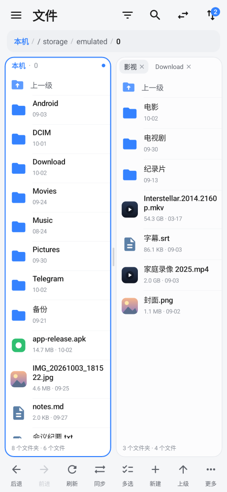
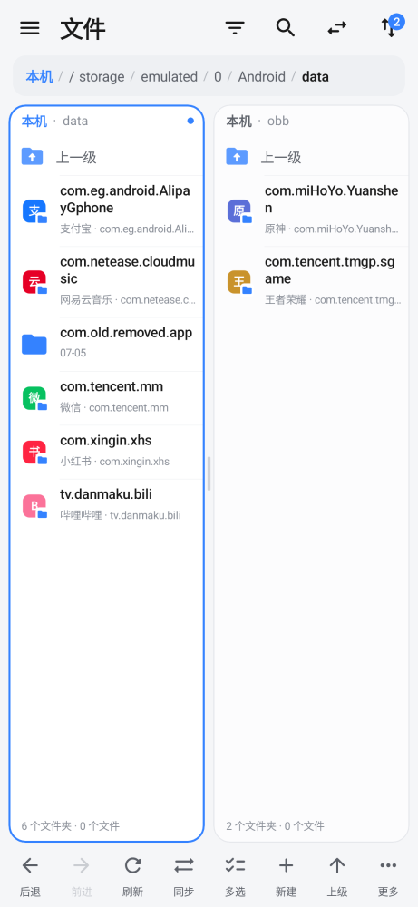
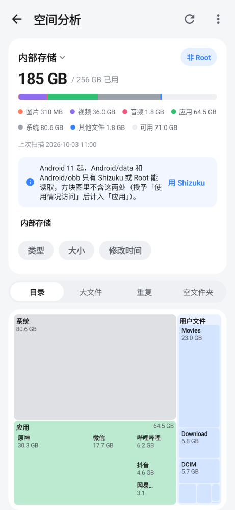
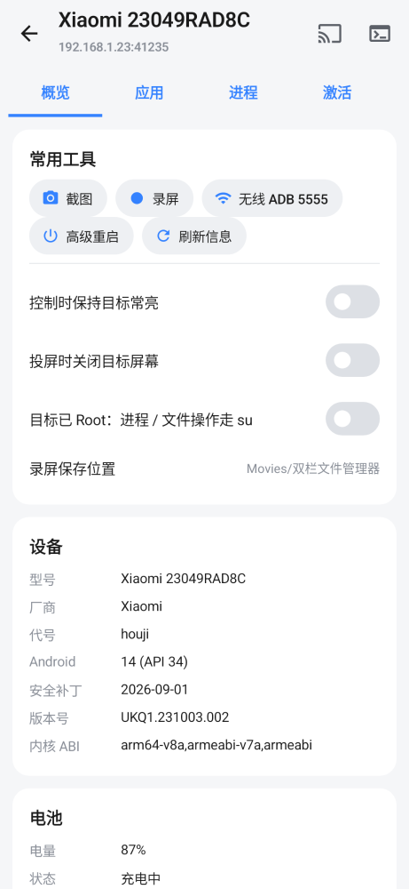
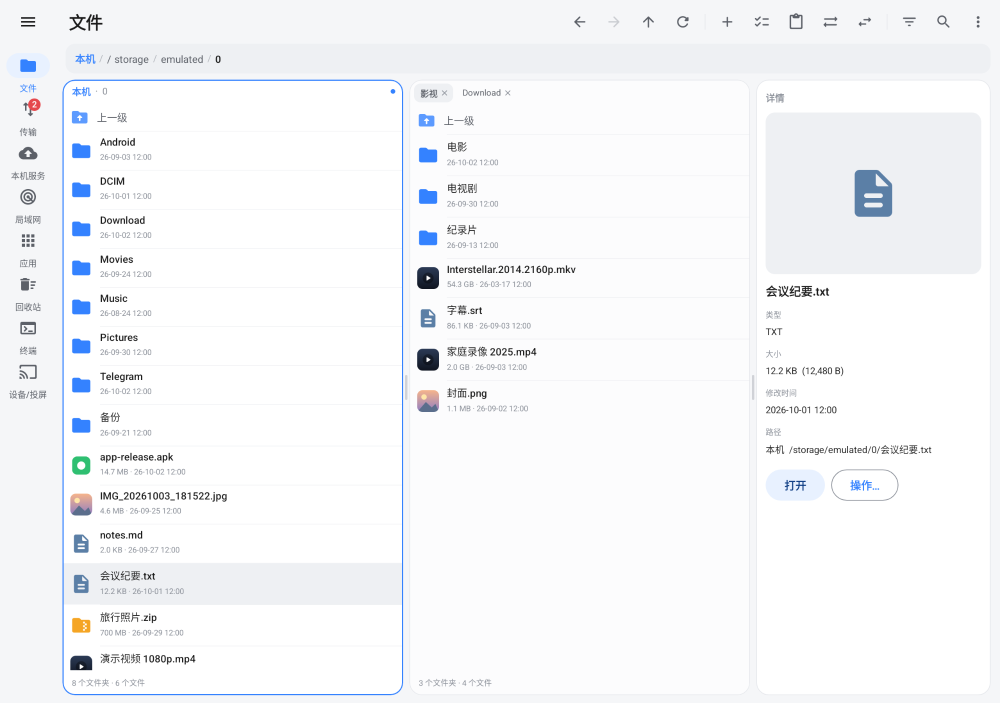
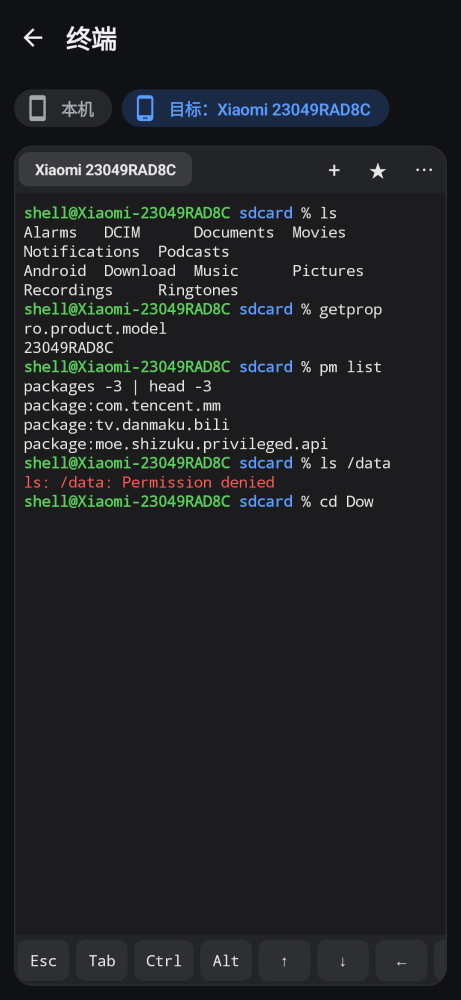

[简体中文](README.md) | **English**

# Dual-Pane File Manager (ghost-files)

[](https://github.com/Ghostpanter/ghost-files/releases/latest)
[](https://github.com/Ghostpanter/ghost-files/releases)

[](LICENSE)

A dual-pane Android file manager in the spirit of **MT Manager** and **MiXplorer**: side-by-side browsing, Root / Shizuku access to `Android/data` and system folders, SMB / FTP / SFTP / WebDAV clients, and the phone as a file server. Screen mirroring, ADB tools, wired Fastboot, a terminal, a storage analyzer and a player are built in.

**Download: [latest stable APK](https://github.com/Ghostpanter/ghost-files/releases/latest)** (currently v0.7.4)

In the English UI the app is called **TwinPane File Manager**. The screenshots below show the Chinese UI.

<p>
  
  
  
  
</p>
<p>
  
  
</p>

## Features

- **Dual-pane browsing**: side-by-side even in phone portrait, with a draggable divider; tabs, multi-select, bookmarks, recycle bin, search and properties
- **Elevated access**: Root (Magisk / KernelSU and similar), Shizuku, or the built-in privilege path (no separate Shizuku install); SAF is also available
- **LAN**: SMB2/3, FTP / FTPS, SFTP and WebDAV clients; the phone can host FTP / WebDAV / SFTP / SMB; background transfer queue with resume
- **Devices and flashing**: scrcpy mirroring, ADB files and tools, wired phone-to-phone USB / OTG, Recovery sideload, and wired Fastboot (getvar, reboot, flash / erase; flashes are refused when the device is locked)
- **Apps and backup**: install APK / APKS / XAPK; app manager (including converting a user app to a system app with Root); backup and restore of contacts, SMS / MMS, call log and calendar
- **Storage analyzer**: treemap, large / duplicate / empty folders; leftovers from uninstalled apps can be cleaned
- **Viewers and tools**: VLC video, text / hex editors, image / PDF / Markdown preview, archives, batch rename

The UI follows a clean HyperOS-like style, with light, dark and OLED black themes and a tablet navigation rail. The default language is Chinese; Settings can follow the system or switch to Simplified Chinese / English.

## Install

- Package `com.ghostpanter.files`, minSdk 28 (Android 9), targetSdk 34
- One universal APK with `arm64-v8a` / `armeabi-v7a` / `x86` / `x86_64`; V1 + V2 signatures, `extractNativeLibs=true`, 16 KB page-aligned
- Signing certificate SHA-256 (check with `apksigner verify --print-certs`):
  `45f679ba66c67e7cb71e40cfec7fe43216f59280f7451ab96813e879ae83c76d`
- Current stable builds use the **Dual-Pane** certificate and can be installed over v0.7.2 / v0.7.3 and later test builds. If you still have a very old build signed with a different certificate, uninstall that copy first — it cannot be upgraded in place.

## Build

```sh
./gradlew :core:test :adb-core:testDebugUnitTest :scrcpy:testDebugUnitTest :app:verifyPaparazziDebug
KEY_PROPS=/path/to/key.properties scripts/build-apk
# Output: artifacts/ghost-files.apk and .sha256
```

`scripts/build-apk` signs with V1 + V2, 16 KB-aligns the APK, and checks V1/V2, targetSdk 34 and all four ABIs. Signing material is not in the repository.

## License

This project is released under the [MIT License](LICENSE).
