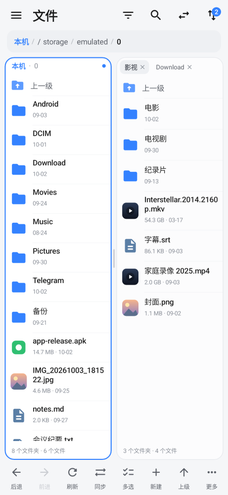
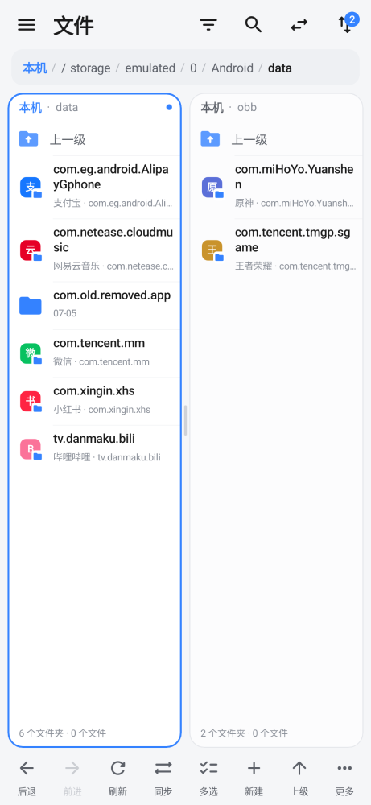
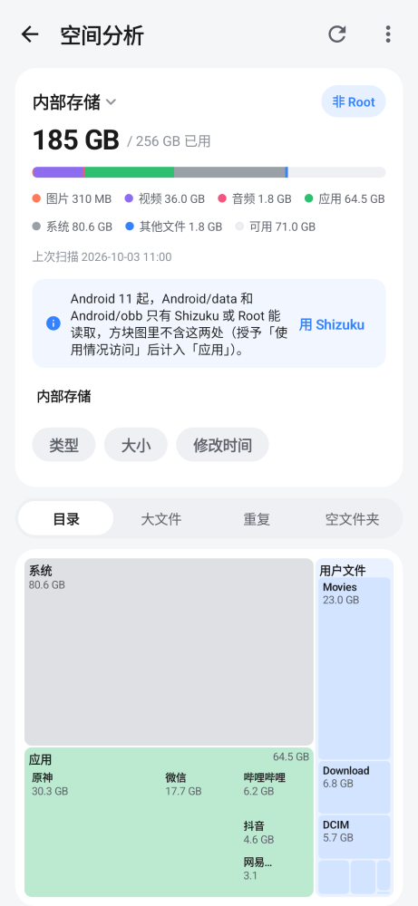
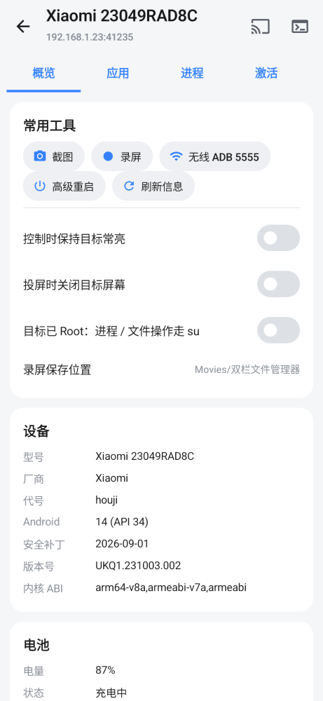
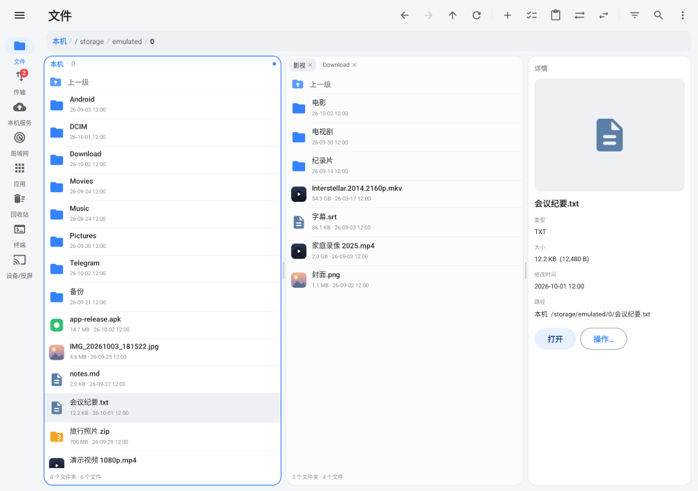
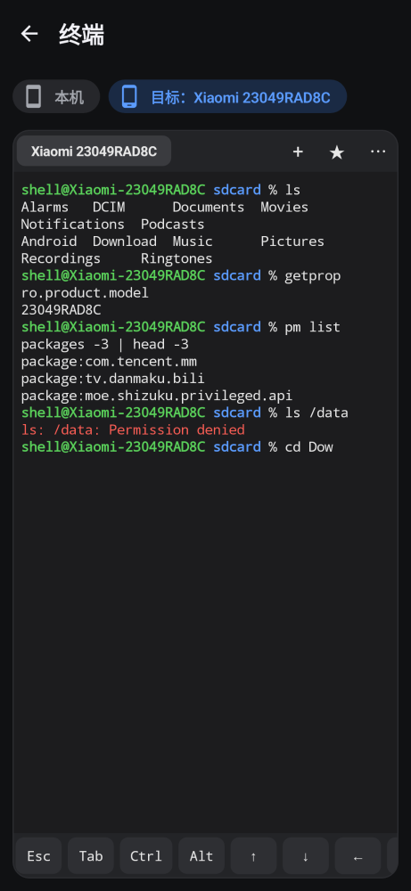

[简体中文](README.md) | **English**

# Dual-Pane File Manager (ghost-files)

[](https://github.com/Ghostpanter/ghost-files/releases/latest)
[](https://github.com/Ghostpanter/ghost-files/releases)

[](LICENSE)

A dual-pane file manager for Android in the spirit of **MT Manager** and **MiXplorer**. It has MT-style side-by-side panes and uses Root or Shizuku to reach `Android/data` and system folders. It connects to **SMB / FTP / FTPS / SFTP / WebDAV**, and it can also turn your phone into a file server. Screen mirroring (scrcpy), ADB tools, a terminal, a storage analyzer and a VLC player are built in. The transfer queue is built specifically so that copying over the LAN does not stall.

**Download: [latest stable APK](https://github.com/Ghostpanter/ghost-files/releases/latest)** (currently v0.7.1)

In the English UI the app is called **TwinPane File Manager**. The screenshots below show the Chinese UI.

<p>
  
  
  
  
</p>
<p>
  
  
</p>

## At a glance

- Package `com.ghostpanter.files`, minSdk 28 (Android 9), targetSdk 34
- One universal APK with `arm64-v8a` / `armeabi-v7a` / `x86` / `x86_64`. It is V1 + V2 signed, with `extractNativeLibs=true` and 16 KB page alignment.
- Signing certificate SHA-256 (check it with `apksigner verify --print-certs`):
  `303564befb25c73f4673f9eafb7001d91fac741fed33e8c4dd91604b016fdc53`
- UI language: Chinese by default. Settings → Language offers "Follow system / 简体中文 / English".
- Kotlin + Jetpack Compose (Material 3)

## Features (v0.7.1)

### Dual-pane browsing
- MT-style dual pane: the two panes stay side by side even on a phone in portrait. You can drag the divider, and a double-tap resets it to half. The active pane has a blue outline, and copy / move go to the other pane by default.
- Each pane has multiple tabs, breadcrumbs, back / forward, go up, and sync with the other pane. You can also swap the two panes.
- Multi-select with select all, invert and select-by-type. With items selected, the bottom bar shows the count and total size, plus copy, move, delete and more.
- Long-press menu: copy / move to the other pane, rename, delete, open with, open as text, compress, extract, share, bookmark, permissions, copy path, properties
- Sorting, filtering and hidden files. There is a recycle bin for local storage, plus bookmarks. Search is recursive (substring or `*` `?` wildcards), and you can search inside files.
- Properties: size (counted recursively for folders), permissions, owner, timestamps, SHA-256
- Thumbnails for images, videos and APKs, also on Root / Shizuku / SAF / network locations

### Interface (clean HyperOS style)
- A light grey background with white rounded cards and a single blue accent. Light, dark and pure-black OLED themes are available.
- Tablets and large screens get:
  - a navigation rail, a persistent side panel, a path bar for each pane and a details panel;
  - a choice of layout mode and display density;
  - keyboard shortcuts, right-click menus and drag and drop.

### Elevated access
- **Root** (su; works with Magisk / KernelSU):
  - browse all of `/`, including `/data`, hidden files and system files;
  - chmod (also recursive) and chown;
  - symlinks;
  - remount read-write.
- **Shizuku** (no root, adb shell privileges): access `Android/data` and `Android/obb` (one combined drawer entry)
- **Built-in privilege** (v0.7.1, no separate Shizuku app): on Android 11+ pair via a notification code and self-connect to wireless debugging; on 9/10 use a PC or OTG ADB starter command; with root it can start directly. External Shizuku is preferred when it is installed and granted.
- **SAF**: grant access to `Android/data` on Android 11–12; USB drives and SD cards
- **App icons on package-name folders**: folders named after a package show that app's icon and name. This works under `Android/data`, `obb`, `media`, `/data/data`, `/data/user` and `/data/app`.

### Remote storage and built-in servers
- Clients: SMB2/3, FTP / FTPS, SFTP (with ProxyJump), WebDAV / HTTPS
- LAN scan: mDNS, NetBIOS name queries and a port probe of the local subnet. SMB share names are detected automatically (guest / anonymous first). One tap fills a scan result into the server form.
- Built-in servers: FTP / FTPS, WebDAV / HTTPS, SFTP and SMB2 (2.1, port 4455 by default, no root needed).
  - They run as a foreground service with a notification.
  - They can be limited to the LAN and can stop automatically when Wi-Fi drops.
  - A random password is generated the first time you turn them on.
- HTTP remote management (with a QR code)
- Background transfer queue: pause / resume / cancel / retry (resumable), progress in the notification, speed, and per-file failure details. Copies and moves within one server run on the server itself.

### Screen mirroring and ADB tools
- **Built-in mirroring (scrcpy)**: connect to another Android device, then mirror and control it. While mirroring you can record straight to MP4, with optional audio and no re-encoding.
- **Device tools**:
  - device info, screenshot, screen recording, enable tcpip 5555, advanced reboot, stay awake, screen off;
  - remote app manager: install APK / APKS / XAPK, push apps from this phone, export installers;
  - process list, one-tap activation, logcat.
- **ADB file access**: browse, copy and move files on the other device in either pane, like any other storage location. Both plain ADB and ADB root work.
- **USB / OTG ADB**: connect with a cable and enable "USB debugging" on the other device. Wireless debugging is not needed.
- **Terminal** (macOS Terminal look):
  - switch between "This device" and "Target device";
  - tabs, history and Tab completion;
  - Ctrl-C/D/L and sticky Ctrl/Alt keys;
  - pinch to zoom the font;
  - saved favourite commands, with JSON import / export.

> The first time you use ADB, pair under Developer options → Wireless debugging on the target device. Over USB, tap "Allow USB debugging" on the target device the first time.

### Installers and apps
- Installs:
  - plain `.apk` files;
  - `.apks` / `.xapk` / `.apkm` bundles and folders of split APKs. The right splits for this device are picked automatically.
- Bundles install through the system installer or silently via Root / Shizuku, and OBB data is copied automatically.
- **Install source** (v0.7.1): silent installs can record Play / this app / leave as-is; the app details screen can show or change the source.
- APK details: icon, version, SDK levels, permissions, installed version
- App manager: export APKs in bulk. With root, you can also back up app data in bulk.
- **Personal data backup & restore** (v0.7.1): contacts, SMS / MMS, call log and calendar

### Storage analyzer
- A treemap shows which folders take the most space. You can filter by type, size or modification time. There are also "Large files", "Duplicates" and "Empty folders" lists.
- Three tiers:
  - **Without root**, it scans internal storage. With "Usage access" granted, it also shows space used by apps and the system.
  - **With Shizuku**, it also reads `Android/data` and `obb`, flags leftovers from uninstalled apps, and can clear app caches.
  - **With root**, it can analyze the whole device.
  - Devices connected over ADB can be analyzed too.
- Duplicates: "keep the best copy, delete the rest" marks a suggested copy to keep in each group. Before deleting, it confirms the count and the space freed, and files go to the recycle bin.
- Results are cached. They show instantly the next time and refresh incrementally in the background.

### Viewers, editors and tools
- Videos play in the built-in VLC player (libVLC). It has playback speed, audio track and subtitle selection, a hardware-decoding toggle and auto-play of the next file. Videos on Root / Shizuku / SAF / network locations stream without copying first. Audio uses the built-in player.
- Text editor (encodings, find and replace, line numbers, common syntax highlighting) and a hex viewer / editor
- Image viewer; Markdown, PDF and font previews; a simple EPUB reader
- Compression:
  - create ZIP / 7z (optional AES password; ZIP can be split into volumes);
  - extract zip / tar* / 7z / RAR4 / ISO / CAB / Zstd / LZ4 (RAR5 is not supported yet);
  - add and remove files inside a ZIP.
- Batch rename, file / folder compare, file encryption (the app's own `.gfenc` format), settings import / export

### Not implemented yet
- WS-Discovery, WebDAV Digest auth (only Basic for now), Kerberos
- RAR5 extraction

## Designed for a stable LAN

Many file managers freeze after copying a little data. The usual reasons are these:
- the transfer runs on the UI thread or on a single shared connection;
- a dropped connection has no timeout, so a blocking read hangs forever;
- cancelling midway still waits for the server's completion reply;
- the whole file is read into memory.

Here is how each is handled:

1. **Background task queue** (`core/transfer/TransferEngine.kt`): every copy and move is queued on IO coroutines. You can set how many run at once (2 by default). The UI only observes progress and is never blocked by a transfer.
2. **Foreground service + WakeLock + high-performance Wi-Fi lock**: transfers keep running with the screen off or the app in the background. The service runs only while there are tasks.
3. **Fixed memory use**: each transfer streams through a single 256 KB buffer, so multi-GB files don't exhaust memory.
4. **Stall watchdog**: if no bytes move for 45 seconds, both streams are closed. For SMB the limit is the per-request timeout + 15 s. The blocked read then throws and is retried instead of hanging forever. Pause and cancel close the streams too, so they respond immediately.
5. **Exponential-backoff retry + resume**: each file is retried up to 5 times (1 s → 2 s → 4 s…, capped at 20 s), with a fresh connection each time. Resuming works like this:
   - SMB and SFTP read and write at an offset;
   - FTP uses REST / APPE;
   - WebDAV downloads use HTTP Range.
   
   The file size is checked after the copy.
6. **Timeouts and keepalive**:
   - connect timeout 10 s, read timeout 30 s;
   - SMB: 90 s per request, with TCP keepalive;
   - SFTP: a keepalive every 15 s;
   - FTP: NOOP on the control connection during transfers;
   - WebDAV: an OkHttp connection pool.
7. **Separate connections for browsing and transfers**: each transfer task opens its own connection to each server and closes it when done. Browsing uses a different connection, so it never waits behind a large transfer, and broken connections are thrown away.
8. **FTP cancel never hangs**: closing a transfer early drops the data connection instead of blocking on `completePendingCommand()`.
9. **Server-side operations**: moves within one server use rename / MOVE. Copies use SMB server-side COPYCHUNK, WebDAV COPY, `cp` on the SFTP server, or `cp -a` for Root / Shizuku. None of that data passes through the phone.
10. **Large folders load in batches**: local and SMB listings stream in chunks, so a folder with tens of thousands of files starts showing right away.
11. **Copy and source deletion are separate steps**: a move deletes the source only after the data is written and the size is verified. If deleting the source fails, it is retried twice. After that the file is reported as "copied, but deleting the source failed: reason", and the whole file is not sent again.
12. **SMB reconnects automatically**: if the connection really drops (Wi-Fi glitch, NAS closing idle connections), the file is reopened on a new connection and continues from the current offset, which doesn't count as a retry. Error cards show the root cause. You can expand the full stack trace and copy the error and the log.
13. **SMB self-heals from stalls**:
    - reads are asynchronous; a read with no answer for 20 s moves to a new connection at the current offset;
    - the read size adapts between 64 KB and 1 MB;
    - idle connections send an SMB2 ECHO every 30 s;
    - if negotiation fails, it falls back to SMB 2.1 / 2.0.2.
14. **SFTP security**: the host key is recorded on first connect (TOFU), and any later change is refused. Passwords are encrypted with an AES-GCM key in the Android Keystore.

## Building

```sh
# Unit tests (core, ADB and mirroring modules) and UI screenshot checks (Paparazzi, no emulator needed)
./gradlew :core:test :adb-core:testDebugUnitTest :scrcpy:testDebugUnitTest :app:verifyPaparazziDebug

# SMB integration and connection-stability tests against a temporary local Samba (needs smbd and sudo)
scripts/test-samba

# Re-record UI screenshots into app/src/test/snapshots/images
./gradlew :app:recordPaparazziDebug

# Build a signed APK (signing material is not in the repo)
KEY_PROPS=/path/to/key.properties scripts/build-apk
# Produces artifacts/ghost-files.apk and .sha256
```

`scripts/build-apk` signs with V1 + V2 and applies 16 KB alignment. It then checks that `apksigner verify --min-sdk-version 23` reports both v1 and v2 as true, that targetSdk is 34, and that all four ABIs are present.

## Test coverage

- **Transfer queue**:
  - copying and moving folder trees across backends;
  - retrying and resuming from an offset after a simulated network drop;
  - the watchdog breaking stalled streams;
  - pause / resume / cancel;
  - conflict policies (overwrite / skip / keep both / resume);
  - files larger than 2 GiB.
- **Protocols**:
  - FTP against an embedded Apache FtpServer;
  - SFTP against an embedded Apache SSHD, including a changed host key and reconnecting after a server restart;
  - WebDAV against MockWebServer;
  - SMB against a temporary Samba via `scripts/test-samba`.
- **Shell backend** (what Root / Shizuku use): the same read/write suite against the local `sh`; hidden files, symlinks, chmod; toybox output parsing
- **Other**:
  - compression (GBK file names, zip-slip protection);
  - LAN scanning, search and the recycle bin;
  - unit tests for the ADB and mirroring modules;
  - UI screenshot tests.

## License

Released under the [MIT License](LICENSE).
