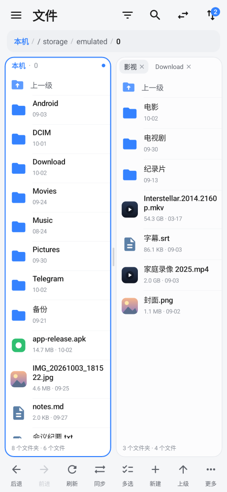
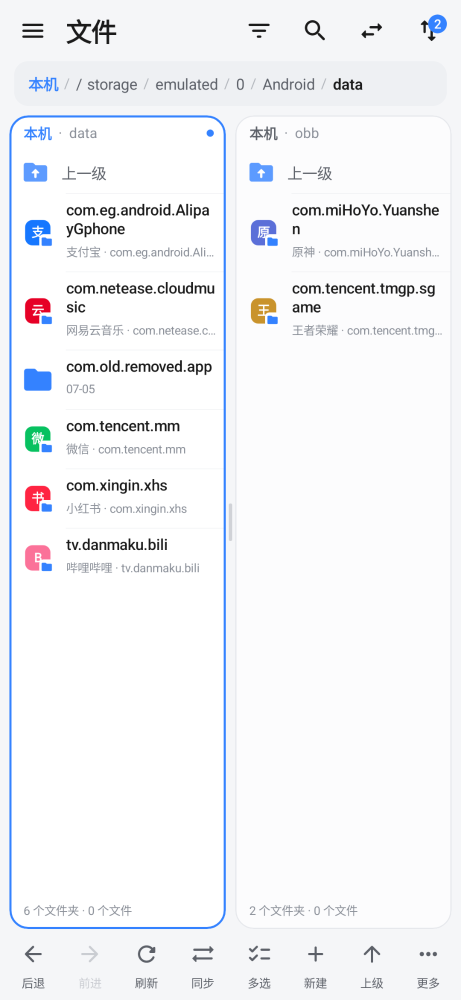
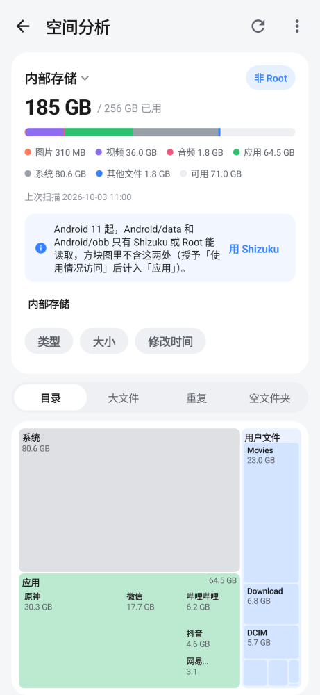
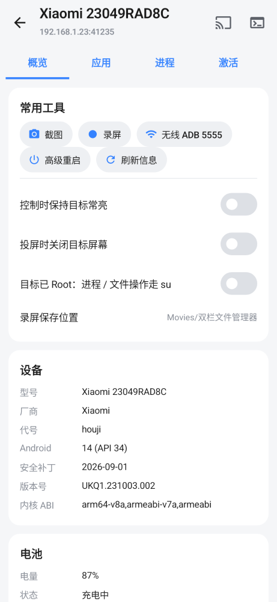
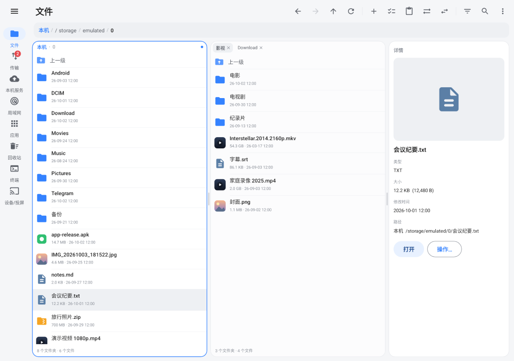
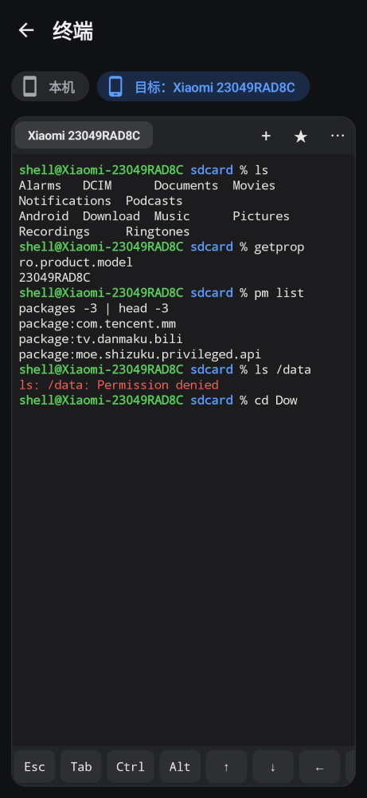

**简体中文** | [English](README.en.md)

# 双栏文件管理器 (ghost-files)

[](https://github.com/Ghostpanter/ghost-files/releases/latest)
[](https://github.com/Ghostpanter/ghost-files/releases)

[](LICENSE)

参照 **MT 管理器** 和 **MiXplorer** 的安卓双栏文件管理器：左右双栏浏览，Root / Shizuku 访问 `Android/data` 和系统目录，连接 SMB / FTP / SFTP / WebDAV，本机也可当服务器。内置投屏、ADB 工具、有线 Fastboot、终端、空间分析和播放器。

**下载：[最新正式版 APK](https://github.com/Ghostpanter/ghost-files/releases/latest)**（当前为 v0.7.4）

<p>
  
  
  
  
</p>
<p>
  
  
</p>

## 主要功能

- **双栏浏览**：手机竖屏也左右并排，可拖动分隔条；多标签、多选、书签、回收站、搜索与属性
- **提权访问**：Root（Magisk / KernelSU 等）、Shizuku，或内置提权（不用另装 Shizuku）；也可走 SAF
- **局域网**：客户端支持 SMB2/3、FTP / FTPS、SFTP、WebDAV；本机可开 FTP / WebDAV / SFTP / SMB 服务；后台传输队列，断点续传
- **设备与刷机**：投屏（scrcpy）、ADB 文件与工具、两机有线互联（USB / OTG）、Recovery Sideload，以及有线 Fastboot（查看变量、重启、刷写 / 擦除分区；未解锁设备拒绝刷写）
- **应用与备份**：安装 APK / APKS / XAPK；应用管理（含 Root 下转为系统应用）；联系人、短信 / 彩信、通话、日历备份与恢复
- **空间分析**：方块图、大文件 / 重复 / 空文件夹；可选清理卸载残留
- **查看与工具**：VLC 视频、文本 / 十六进制编辑、图片 / PDF / Markdown 预览、压缩解压、批量重命名

界面为 HyperOS 清爽风格，支持浅色 / 深色 / OLED 纯黑；平板有侧边导航。默认中文，设置中可改「跟随系统 / 简体中文 / English」。

## 安装

- 包名 `com.ghostpanter.files`，minSdk 28（Android 9），targetSdk 34
- 一个通用安装包，含 `arm64-v8a` / `armeabi-v7a` / `x86` / `x86_64`；V1 + V2 签名，`extractNativeLibs=true`，16KB 页对齐
- 签名证书 SHA-256（可用 `apksigner verify --print-certs` 校验）：
  `45f679ba66c67e7cb71e40cfec7fe43216f59280f7451ab96813e879ae83c76d`
- 当前正式版使用 **Dual-Pane** 证书，可覆盖安装 v0.7.2 / v0.7.3 及后续测试包。若还装着很早的旧签名包（非 Dual-Pane 证书），需要先卸载再安装，不能直接覆盖。

## 构建

```sh
./gradlew :core:test :adb-core:testDebugUnitTest :scrcpy:testDebugUnitTest :app:verifyPaparazziDebug
KEY_PROPS=/path/to/key.properties scripts/build-apk
# 输出 artifacts/ghost-files.apk 和 .sha256
```

`scripts/build-apk` 会用 V1 + V2 签名并做 16KB 对齐，然后检查 V1/V2、targetSdk 34 和四个 ABI。签名材料不在仓库里。

## 许可证

本项目基于 [MIT 许可证](LICENSE) 开源。
